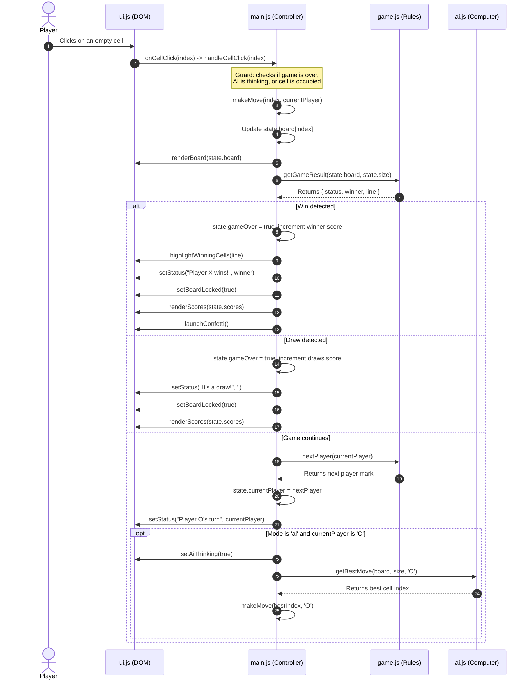
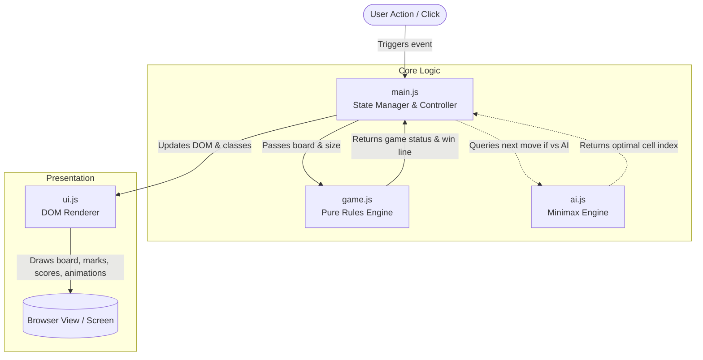

# TicTime Architecture

This document describes the architectural layout, component responsibilities, and data flow of TicTime.

---

## 1. File Structure and Roles

TicTime is built as a zero-dependency vanilla web application emphasizing clear separation of concerns:

- **`index.html`**
  - Defines the semantic page structure (header, logo, dark-mode toggle, scoreboard, status pill, game board, control buttons, game options, move history panel, and footer).
  - Hosts shared SVG gradients used for mark rendering.
  - Loads scripts in order of dependencies: `js/game.js` -> `js/ai.js` -> `js/ui.js` -> `js/main.js`.

- **`css/styles.css`**
  - Provides theme styling (light and dark mode) via CSS custom properties (`:root` and `[data-theme="dark"]`).
  - Manages fluid grid layouts, scoreboard cards, status pill, cell responsiveness, hover previews, win pulse effects, and floating background blobs.
  - Handles mobile responsiveness and accessibility constraints (`prefers-reduced-motion`).

- **`js/game.js`**
  - **Pure rules engine**. Contains no DOM interactions or UI logic.
  - Computes winning line combinations (`getWinLines`) across supported board sizes (3×3, 4×4, 5×5).
  - Provides helpers for empty board creation (`createEmptyBoard`) and player turn switching (`nextPlayer`).
  - Evaluates the game state (`getGameResult`) to determine whether there is a winner, a draw, or if the game is still in progress.

- **`js/ai.js`**
  - Contains decision-making heuristics and optimal Minimax move selection for the "vs Computer" mode.
  - Supports board sizes with depth-limited evaluation and immediate block/win recognition.

- **`js/ui.js`**
  - **Presentation layer**. Handles all direct DOM manipulation.
  - Dynamically builds the grid cells (`buildBoard`).
  - Renders marks (animated SVG for X and O) inside squares (`renderBoard`).
  - Highlights winning cells (`highlightWinningCells`), sets status messages and badges (`setStatus`), manages board lock state (`setBoardLocked`), and triggers confetti animations (`launchConfetti`).
  - Updates scoreboard counters (`renderScores`) and applies theme attributes (`setTheme`).

- **`js/main.js`**
  - **Controller and application state manager**.
  - Owns the single state object (`board`, `currentPlayer`, `scores`, `mode`, `size`, `gameOver`, `theme`).
  - Orchestrates events by binding DOM listeners (`handleCellClick`, `startNewGame`, `resetScores`, `toggleTheme`, `handleModeChange`, `handleSizeChange`).
  - Coordinates communication between `game.js`, `ai.js`, and `ui.js`.

---

## 2. Step-by-Step Flow: Clicking a Square

Here is what happens under the hood when a player clicks a cell on the board:

---

## 3. High-Level Data Flow Diagram

