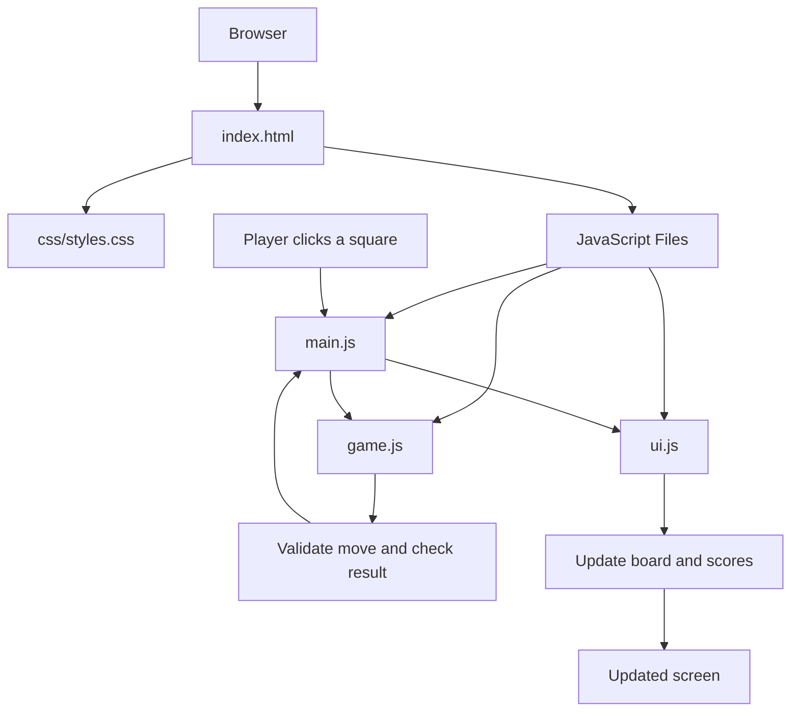

# Architecture
# TicTime – Project Architecture

This document explains how TicTime works internally, how its JavaScript files communicate, and how a player's action updates the game board.

## 1. Project Overview

TicTime is a browser-based Tic-Tac-Toe game developed using:

- **HTML** – Defines the structure of the game.
- **CSS** – Controls the appearance, layout, animations, and themes.
- **JavaScript** – Handles game rules, user interactions, and screen updates.

The project uses three main JavaScript files:

1. `js/game.js`
2. `js/ui.js`
3. `js/main.js`

Each file has a separate responsibility, making the project easier to understand, maintain, and extend.

## 2. Project Structure

```text
TicTime/
│
├── index.html
│
├── css/
│   └── styles.css
│
├── js/
│   ├── main.js
│   ├── ui.js
│   └── game.js
│
├── docs/
│   └── ARCHITECTURE.md
│
├── README.md
└── ...
```

## 3. Role of Each File

### A. index.html – Application Structure

`index.html` is the entry point of the application.

Its responsibilities include:

- Defining the HTML structure.
- Creating the game board and its nine squares.
- Providing buttons for restarting and other game actions.
- Connecting CSS and JavaScript files.
- Providing the elements that JavaScript updates.

It provides the basic structure that appears in the browser.

### B. css/styles.css – Visual Design

This file controls how the game looks.

Its responsibilities include:

- Styling the game board and squares.
- Defining colours, fonts, and layouts.
- Creating hover effects and animations.
- Styling buttons and score displays.
- Supporting responsive layouts and themes.

CSS controls presentation, not the actual game rules.

### C. js/game.js – Game Logic

This file handles the core rules of Tic-Tac-Toe.

Its responsibilities include:

- Managing the rules for valid moves.
- Checking whether a player has won.
- Detecting a draw.
- Evaluating the current board state.

The game logic is kept separate from DOM manipulation so that the rules can be understood independently of the interface.

### D. js/ui.js – User Interface

This file manages how game information is displayed.

Its responsibilities include:

- Updating the board with X and O.
- Displaying scores.
- Updating game status messages.
- Managing visual themes.
- Triggering visual effects such as confetti.

It connects the game's state to what the player sees on the screen.

### E. js/main.js – Application Controller

This file connects the game logic and user interface.

Its responsibilities include:

- Initialising the game.
- Maintaining and coordinating game state.
- Registering event listeners.
- Handling square clicks.
- Calling functions from `game.js` and `ui.js`.
- Coordinating game resets and other interactions.

It acts as the main controller of the application.

## 4. How the Files Work Together

The application follows a simple flow:

1. The browser loads `index.html`.
2. HTML creates the game board and other interface elements.
3. CSS styles the application.
4. JavaScript files are loaded.
5. `main.js` initialises the game and registers event listeners.
6. The player interacts with the board.
7. `main.js` handles the interaction and coordinates the game logic.
8. `game.js` evaluates the move and determines the game result.
9. `ui.js` updates the board and other visual elements.
10. The browser displays the updated game.

## 5. Data Flow Diagram

The following diagram shows how the files communicate during gameplay.



## 6. What Happens When a Player Clicks a Square?

Let's understand the complete process step by step.

**Step 1: User Interaction**

The player clicks one of the nine squares on the game board.

**Step 2: Event Handling**

`main.js` receives the click through the registered event listener.

**Step 3: Game Logic**

`main.js` coordinates with `game.js` to validate the move and update or evaluate the game state.

**Step 4: Check Game Result**

The game logic checks:

- Is the selected square available?
- Has a player completed a winning combination?
- Is the board completely filled?
- Is the game a draw?

**Step 5: Update the Interface**

`main.js` coordinates with `ui.js` to display the updated board, player symbols, scores, and game status.

**Step 6: Screen Update**

The browser displays the updated interface, allowing the next player to make a move if the game is still running.

## 7. Separation of Responsibilities

The project follows a separation-of-concerns approach.

| File | Main Responsibility |
|---|---|
| `index.html` | Application structure |
| `styles.css` | Visual presentation |
| `game.js` | Game rules and calculations |
| `ui.js` | Display and visual updates |
| `main.js` | Events and coordination |

This structure provides several benefits:

- Easier debugging.
- Better code organisation.
- Simpler maintenance.
- Easier collaboration for contributors.
- Ability to improve individual components without unnecessarily changing others.

## 8. Summary

TicTime uses a simple modular JavaScript architecture.

- `game.js` decides what happens in the game.
- `ui.js` decides how the game appears.
- `main.js` coordinates the application.
- `index.html` provides the structure.
- `styles.css` provides the visual design.

Together, these files create an interactive Tic-Tac-Toe experience using plain HTML, CSS, and JavaScript without requiring a framework or build system.

---

**For contributors:** When modifying the project, try to keep game rules, interface updates, and application event handling in their respective files. This makes future development easier.
 

